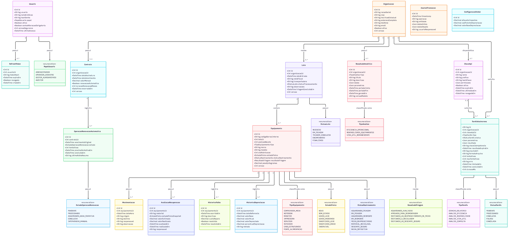

# Registro de decisões arquiteturais — AV3 / GreenCode

Este documento registra as decisões arquiteturais adotadas no GreenCode AV3. As decisões foram atualizadas com base na estrutura do repositório, no `schema.prisma`, nas migrações, nos módulos do backend, no frontend e no documento técnico. Uma capacidade só é descrita como implementada quando há evidência no código atual.

## Diagramas da arquitetura

Os diagramas complementam este registro e apresentam duas visões diferentes do sistema:

### Diagrama de componentes

O diagrama de componentes apresenta a organização do frontend, da API, dos módulos de negócio, da persistência e do processamento assíncrono.

### Diagrama de classes

O diagrama de classes representa as entidades persistidas pelo Prisma, seus principais atributos e os relacionamentos do modelo de dados.

---

## Decisões adotadas

### D-01 — Monólito modular com separação em camadas

- **Decisão:** manter a aplicação como monólito modular, com API HTTP e worker em processos separados. No backend, as responsabilidades são organizadas em rotas/controllers, services, repositories e funções de domínio em `backend/src/dominio/`.
- **Motivo:** preservar a base funcional da AV2, separar regras de negócio da camada HTTP e da persistência e atender aos novos requisitos sem introduzir a complexidade operacional de microserviços.
- **Alternativa não adotada:** dividir cada módulo de negócio em um serviço independente.
- **Trade-off:** o desenvolvimento e a implantação permanecem mais simples, mas os módulos compartilham o mesmo código-base e o mesmo banco relacional. API e worker podem ser escalados como processos distintos.

### D-02 — TypeScript, Fastify, Prisma e MySQL

- **Decisão:** utilizar Node.js 22.12 ou superior, TypeScript, Fastify 5, Prisma 7.10.1, `@prisma/adapter-mariadb` e MySQL 8.0.16 ou superior.
- **Motivo:** manter tipagem estática, validação das entradas HTTP, persistência relacional e compatibilidade com as constraints SQL utilizadas pelo domínio.
- **Alternativa não adotada:** substituir o ORM, o adaptador ou o banco nesta etapa.
- **Trade-off:** schema Prisma, adaptador e migrações SQL precisam permanecer compatíveis entre si. Regras que dependem de `CHECK` são mantidas nas migrações SQL.

### D-03 — Modelo relacional e preservação de histórico

- **Decisão:** manter relações explícitas entre organizações, contratos, lotes, equipamentos e seus registros históricos. As relações operacionais relevantes utilizam restrições referenciais, incluindo `onDelete: Restrict` onde a remoção poderia comprometer a rastreabilidade.
- **Motivo:** preservar integridade referencial e histórico operacional, especialmente movimentações, avaliações, falhas e depreciação de equipamentos.
- **Alternativa não adotada:** permitir exclusão em cascata indiscriminada de registros operacionais.
- **Trade-off:** a remoção de registros depende de critérios de exclusão segura; dados com histórico vinculado não podem ser apagados livremente.

### D-04 — Autenticação JWT, refresh tokens e papéis

- **Decisão:** utilizar JWT de acesso, refresh tokens persistidos como hashes, rotação de refresh token e autorização por papel nas rotas internas.
- **Motivo:** permitir sessões revogáveis e aplicar o princípio do menor privilégio nas operações administrativas e operacionais.
- **Trade-off:** as permissões precisam ser verificadas no backend em cada endpoint protegido. A proteção visual de rotas no frontend não substitui a autorização da API.
- **Limitação:** eventos de autenticação registrados no journal são best-effort e independentes da transação de sessão; não há garantia de atomicidade entre o evento de segurança e a operação de autenticação.

### D-05 — Transações e concorrência

- **Decisão:** operações que atualizam entidades relacionadas e o journal utilizam transações Prisma. Entidades com mutações concorrentes utilizam campos de versão e verificações condicionais nos fluxos em que isso foi implementado.
- **Motivo:** evitar commits parciais, detectar conflitos de atualização e preservar a consistência dos registros de auditoria associados às operações de domínio.
- **Limitação:** `ConfiguracaoGlobal` não possui controle de versão explícito; alterações concorrentes nessa linha seguem a política do banco e a implementação atual do serviço.

### D-06 — Journal de auditoria compartilhado

- **Decisão:** utilizar `JournalTransacao` como registro comum de operações de domínio e eventos de segurança, armazenando entidade, operação, responsável, timestamp e snapshots JSON quando aplicáveis.
- **Motivo:** manter uma fonte comum para consulta de auditoria sem criar mecanismos paralelos por módulo.
- **Alternativa não adotada:** manter um journal independente para cada módulo.
- **Limitação:** eventos de autenticação são gravados de forma independente e best-effort, pois falhas de login não compartilham necessariamente uma transação de domínio. Não se afirma atomicidade para esses eventos.

### D-07 — Separação entre resultado de triagem, rastreamento e baixa

- **Decisão:** `resultadoTriagem` representa a decisão de destino do equipamento; `statusRastreamento` representa sua situação operacional. A baixa definitiva é uma operação separada, autorizada e justificada.
- **Motivo:** não confundir uma decisão de triagem com a execução física do destino do equipamento nem inferir decisões históricas a partir de estados atuais.
- **Trade-off:** relatórios operacionais que consultam o estado atual não reconstroem automaticamente todos os estados históricos a partir do journal.

### D-08 — Configuração global persistida e validada

- **Decisão:** utilizar a linha `ConfiguracaoGlobal` como fonte persistente para alíquota de impostos e parâmetros de depreciação. O seed inicializa os valores; a consulta GET é somente leitura e as alterações explícitas passam pelo serviço de configuração.
- **Motivo:** centralizar parâmetros compartilhados e evitar valores divergentes entre módulos.
- **Integridade:** as migrações mantêm constraints SQL para limitar `aliquotaImpostos` e `coeficienteDepreciacao` ao intervalo de 0 a 1 e exigir `valorBaseDepreciacao` maior que zero.
- **Limitação:** o modelo possui uma linha global identificada por `id` padrão 1 e não implementa versionamento otimista próprio.

### D-09 — Relatórios financeiros e operacionais

- **Decisão:** o relatório financeiro considera contratos vigentes em algum instante do período consultado, levando em conta assinatura, vencimento e encerramento antecipado. Os valores apresentados são valores contratuais mensais.
- **Motivo:** representar a sobreposição temporal da vigência efetiva dos contratos.
- **Limitação:** o relatório não representa receita efetivamente recebida nem reconhecimento contábil. O relatório por organização agrupa equipamentos pela situação atual e não reconstrói snapshots históricos.

### D-10 — Isolamento dos ambientes e testes

- **Decisão:** manter banco de desenvolvimento separado do banco de integração, com `TEST_DATABASE_URL` apontando para um banco cujo nome termina em `_test`. O Redis de integração também deve ser isolado por `TEST_REDIS_URL`.
- **Motivo:** impedir que operações de limpeza da suíte de integração atinjam dados de desenvolvimento ou produção.
- **Trade-off:** é necessário conferir as URLs de banco e Redis antes de preparar o banco ou executar testes de integração.

### D-11 — Exclusão física condicionada de lotes e equipamentos

- **Decisão:** disponibilizar exclusão física de lotes e equipamentos somente quando as regras de segurança forem satisfeitas, sem exclusão em cascata e sem introduzir estados improvisados de exclusão lógica.
- **Lote:** excluir somente quando estiver em `RECEBIDO` e não possuir equipamentos vinculados. Se houver equipamentos ou o lote estiver em outro estado operacional, bloquear a operação com HTTP 409. A operação não remove equipamentos para satisfazer a condição.
- **Equipamento:** excluir somente no estado inicial e sem movimentações, dados de triagem/baixa ou eventos operacionais próprios no journal. Se houver histórico operacional, bloquear a remoção com HTTP 409.
- **Autorização:** reutilizar os papéis autorizados a gerir lotes/equipamentos (`ADMINISTRADOR` e `GESTOR_ALMOXARIFADO`), sem ampliar a autorização para operador ou auditor.
- **Integridade e concorrência:** verificar vínculos antes da remoção, condicionar a operação à versão lida e manter as FKs restritivas como proteção final contra concorrência.
- **Auditoria:** gravar a operação `EXCLUIR` com snapshot anterior dentro da mesma transação. Se a gravação do journal falhar, a exclusão não deve ser confirmada.
- **Alternativas rejeitadas:** exclusão em cascata, remoção de equipamentos já triados ou baixados, exclusão lógica improvisada e remoção de registros históricos para contornar FKs.

### D-12 — Camada analítica com cálculos nativos

- **Decisão:** implementar os serviços analíticos em `backend/src/modules/analises/`, utilizando funções explícitas em TypeScript/JavaScript nativo, sem importar `simple-statistics` ou `mathjs` nesta versão.
- **Motivo:** as fórmulas atuais são suficientemente simples para implementação direta, auditável e sem dependências estatísticas adicionais.
- **Alternativa não adotada:** adicionar bibliotecas estatísticas externas sem necessidade demonstrada pelo conjunto atual de cálculos.
- **Trade-off:** fórmulas, validações e testes permanecem sob responsabilidade do projeto e precisam ser mantidos junto ao código dos serviços.

### D-13 — Eficiência operacional baseada na conclusão da triagem do lote

- **Decisão:** calcular a duração da triagem por lote a partir de `dataEntrada` e `triagemConcluidaEm`, utilizando `duracaoHoras = (triagemConcluidaEm - dataEntrada) / 3.600.000`.
- **Motivo:** utilizar marcos temporais persistidos e comparáveis para identificar duração média e variações do processo.
- **Saídas:** amostra, registros ignorados, média, mínimo, máximo e indicação de suficiência da amostra, considerando três observações como mínimo.
- **Limitação:** não há atribuição confiável do tempo total do lote a um operador individual; portanto, a análise não deve ser apresentada como ranking individual de operadores.

### D-14 — Rentabilidade como análise de valores de recuperação

- **Decisão:** agrupar avaliações de recuperação por tipo de equipamento, snapshot do estado físico, marca e modelo, apresentando médias estimadas e realizadas com contagens independentes.
- **Motivo:** permitir comparar o potencial estimado e os valores efetivamente registrados na recuperação.
- **Limitação:** `valorEstimado` e `valorRealizado` são séries independentes. A análise não representa receita, lucro líquido, ROI ou margem, pois não agrega custos totais e despesas.

### D-15 — Previsão exploratória de vida útil por regressão linear simples

- **Decisão:** utilizar regressão linear simples sobre o histórico de depreciação de cada equipamento. O eixo `x` representa dias desde a primeira observação e `y` representa `valorAtual`. A implementação registra o método `REGRESSAO_LINEAR_SIMPLES`.
- **Motivo:** produzir uma estimativa interpretável a partir das observações históricas efetivamente armazenadas.
- **Critérios:** exigir pelo menos três observações e variação entre datas. Inclinação não negativa ou valor atual não positivo impedem a previsão.
- **Limitações:** trata-se de extrapolação linear exploratória até valor depreciado zero, não de garantia de vida física. Falhas e custos de reparo são contexto descritivo, não preditores do modelo. O cálculo não incorpora intensidade de uso, obsolescência, ambiente, fabricante ou outras variáveis externas; o R² não estabelece causalidade.

### D-16 — Persistência do histórico analítico

- **Decisão:** persistir cada execução em `ResultadoAnalitico`, com tipo, título, descrição, dados JSON, parâmetros, período, versão do modelo e data de geração.
- **Motivo:** permitir consultar resultados anteriores sem recalcular a análise e manter rastreabilidade da versão utilizada.
- **Trade-off:** cada execução gera um novo registro. A edição do registro altera título/descrição, não os dados calculados; a exclusão remove o registro.
- **Limitação:** não é criado histórico retroativo artificial. As análises dependem dos dados efetivamente registrados no sistema.

### D-17 — API pública separada e versionada

- **Decisão:** manter os endpoints destinados a parceiros no agrupamento `/api/v1/public`, separado das rotas internas e administrativas.
- **Motivo:** delimitar a superfície de integração externa, explicitar o versionamento e permitir políticas de autenticação e autorização próprias.
- **Rotas públicas:** `POST /lotes`, `GET /lotes`, `GET /lotes/:id`, `GET /equipamentos/:id/rastreabilidade`, `GET/POST /analises`, `GET /tarefas/:id` e `GET /tarefas/:id/download`.
- **Autorização:** cada rota exige a permissão correspondente da chave, como `LOTES_ESCRITA`, `LOTES_LEITURA`, `RASTREABILIDADE_LEITURA` ou `ANALISES_LEITURA`.
- **Autorização assíncrona:** a solicitação e o polling de análises usam `ANALISES_LEITURA`; a tarefa é vinculada à organização e à chave de API que a criou. Os escopos genéricos `TAREFAS_LEITURA` e `TAREFAS_ESCRITA` permanecem reservados.

### D-18 — Chaves de API vinculadas a organizações

- **Decisão:** cada chave de API é vinculada a uma organização e possui nome, prefixo, hash, permissões, estado de ativação e datas de expiração/uso/revogação.
- **Segurança:** a chave original utiliza o prefixo `gcp_live_`, é apresentada somente no momento da criação e o banco armazena seu hash SHA-256 e prefixo, não o segredo completo.
- **Gerenciamento:** as operações administrativas de criação, listagem, consulta, revogação e rotação ficam no módulo `/api/v1/chaves-api`, protegido por JWT e papel `ADMINISTRADOR`.
- **Motivo:** separar a identidade de integração externa das credenciais de usuários internos e aplicar menor privilégio por chave.
- **Limitação:** a organização utilizada nas operações públicas é obtida da chave autenticada; o parceiro não pode escolher livremente outro `organizacaoId` no corpo da requisição.

### D-19 — Rate limit da API pública

- **Decisão:** aplicar limite de 120 requisições por minuto no escopo das rotas públicas. A chave do limitador utiliza o hash SHA-256 da chave apresentada; quando não há `x-api-key`, utiliza o IP.
- **Motivo:** reduzir abuso e limitar o volume de chamadas externas.
- **Limitação:** o limite atual é fixo no código e não representa uma quota configurável individual por parceiro. O armazenamento em memória/instância não deve ser tratado como limite global distribuído entre múltiplas instâncias.

### D-20 — Processamento assíncrono com BullMQ e Redis

- **Decisão:** utilizar BullMQ sobre Redis para coordenar a entrega e execução de tarefas demoradas. A API HTTP e o worker são processos separados; o worker é iniciado por `backend/src/worker.ts`.
- **Responsabilidades:** MySQL (`TarefaAssincrona`) é o registro durável e fonte de verdade do estado; Redis/BullMQ coordenam fila, espera, execução e retry; o producer persiste a tarefa no MySQL antes de publicá-la no Redis.
- **Motivo:** evitar manter requisições HTTP abertas durante relatórios e análises demorados. A API pode responder HTTP 202 com o identificador da tarefa.
- **Trade-off:** para processar tarefas, Redis e worker precisam estar ativos além da API.

### D-21 — Estados, tentativas, idempotência e reconciliação de tarefas

- **Decisão:** manter o ciclo de vida da tarefa em `TarefaAssincrona`, com estados `PENDENTE`, `PROCESSANDO`, `CONCLUIDA`, `FALHOU` e `CANCELADA`.
- **Retry:** o número máximo de tentativas é configurável por `TASK_MAX_ATTEMPTS` (padrão 3), com backoff exponencial iniciado em `TASK_BACKOFF_MS` (padrão 5.000 ms).
- **Idempotência:** aceitar `Idempotency-Key` opcional, armazenando hash SHA-256 e escopo por usuário/agenda. A mesma chave e o mesmo payload retornam a tarefa existente; payload diferente resulta em HTTP 409.
- **Recuperação:** o worker utiliza reivindicação condicional no MySQL, heartbeat e reconciliação periódica. Tarefas pendentes e tarefas `PROCESSANDO` obsoletas podem ser verificadas e reenfileiradas quando necessário.
- **Resiliência:** se a publicação inicial no Redis falhar, a tarefa permanece persistida como pendente e pode ser recuperada pela reconciliação.
- **Retenção:** o resultado JSON expira após `TASK_RESULT_TTL_HOURS` (padrão 168 horas); o payload expirado é limpo pela reconciliação, enquanto o registro da tarefa permanece até exclusão explícita.

### D-22 — Agendamento recorrente executado pelo worker

- **Decisão:** utilizar o scheduler nativo do BullMQ (`upsertJobScheduler`) para agendar a análise completa recorrente, com ID estável `greencode-analises-completas-diarias`, expressão cron e timezone configuráveis.
- **Motivo:** manter o agendamento integrado à infraestrutura de filas, sem introduzir `node-cron` ou iniciar o scheduler no processo HTTP.
- **Configuração:** o agendamento é opt-in e permanece desabilitado por padrão (`ANALYTICS_SCHEDULE_ENABLED=false`). Cada ocorrência despacha uma tarefa `ANALISE_COMPLETA` com chave idempotente derivada do ID do job.
- **Limitação:** os logs de scheduler medem o despacho da tarefa; a duração real do processamento é persistida em `TarefaAssincrona.duracaoMs`.

### D-23 — Frontend como cliente HTTP da API

- **Decisão:** manter o frontend como aplicação React/Vite/TypeScript, com roteamento, guards de acesso, contexto de autenticação, cliente HTTP e cache de requisições. A interface consome a API por HTTP e JSON.
- **Motivo:** separar a apresentação e a experiência do usuário das regras de negócio e da persistência.
- **Segurança:** a filtragem de navegação e os guards melhoram a experiência, mas não substituem as verificações de papel e permissão executadas no backend.
- **Alternativa não adotada:** permitir acesso direto do navegador ao MySQL ou Redis.

### D-24 — Documentação HTTP centralizada em Swagger/OpenAPI

- **Decisão:** ampliar a documentação Swagger/OpenAPI existente para documentar os endpoints internos e públicos, mantendo a interface em `/docs` e o documento em `/openapi.json`.
- **Motivo:** evitar documentação paralela e permitir exploração dos contratos HTTP em um único local.
- **Trade-off:** schemas, parâmetros, respostas, códigos de erro e mecanismos de autenticação precisam ser mantidos sincronizados com as rotas implementadas.

---

## Limitações conhecidas e decisões futuras

- A camada analítica atual utiliza cálculos nativos; bibliotecas como `simple-statistics` e `mathjs` podem ser avaliadas caso novos métodos justifiquem dependências adicionais.
- A previsão de vida útil é exploratória e depende da quantidade e qualidade do histórico de depreciação disponível.
- A API pública oferece submissão/polling de análises em JSON; exportação CSV/PDF e webhooks permanecem futuras evoluções.
- Os resultados de tarefas são armazenados como JSON no MySQL. Armazenamento externo de arquivos não está implementado.
- Webhooks, quotas individuais por parceiro, rate limit distribuído, métricas centralizadas, tracing distribuído, exportação CSV/PDF, modelos preditivos multivariados e benchmark de carga permanecem evoluções futuras.
- A retenção remove o payload de resultado após a expiração, mas o registro da tarefa permanece até exclusão explícita.
- O agendamento diário permanece desabilitado por padrão e depende de configuração explícita do ambiente.

### D-25 — Relatórios analíticos assíncronos para parceiros

- **Decisão:** expor `POST /api/v1/public/analises`, `GET /tarefas/:id` e `GET /tarefas/:id/download` dentro do prefixo público versionado.
- **Processamento:** reutilizar o producer, a fila BullMQ, o worker, a política de retry, a persistência e a retenção já existentes. O tipo padrão é `ANALISE_COMPLETA`; o parceiro pode solicitar uma análise específica.
- **Segurança:** organização e chave são derivadas da API key autenticada. A consulta da tarefa exige correspondência simultânea de `organizacaoId` e `chaveApiId`, evitando acesso por outra chave, inclusive da mesma organização.
- **Idempotência:** `Idempotency-Key` opcional com escopo por chave de API.
- **Formato:** resultado JSON persistido no MySQL e disponibilizado por download autenticado enquanto não expirar.

### D-26 — Comparação mensal da eficiência operacional

- **Decisão:** acrescentar série mensal à análise de eficiência, agrupando pela data UTC de conclusão da triagem (`triagemConcluidaEm`).
- **Saídas:** amostra, média, mínimo, máximo e suficiência amostral para cada mês.
- **Limitação preservada:** o modelo de dados não oferece atribuição confiável de lote a operador individual; não são fabricados identificadores nem rankings de operadores.
